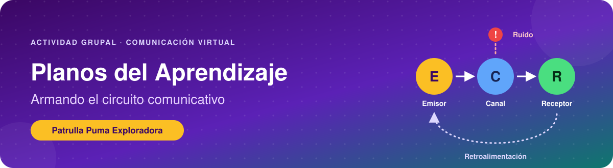
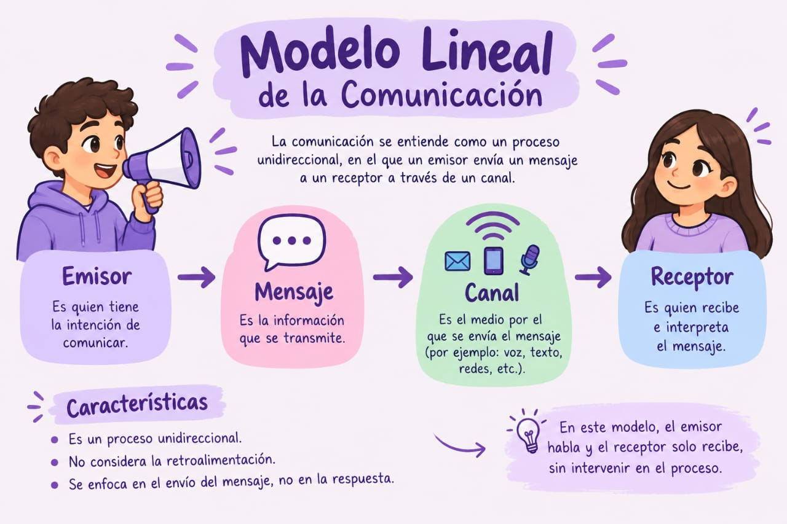
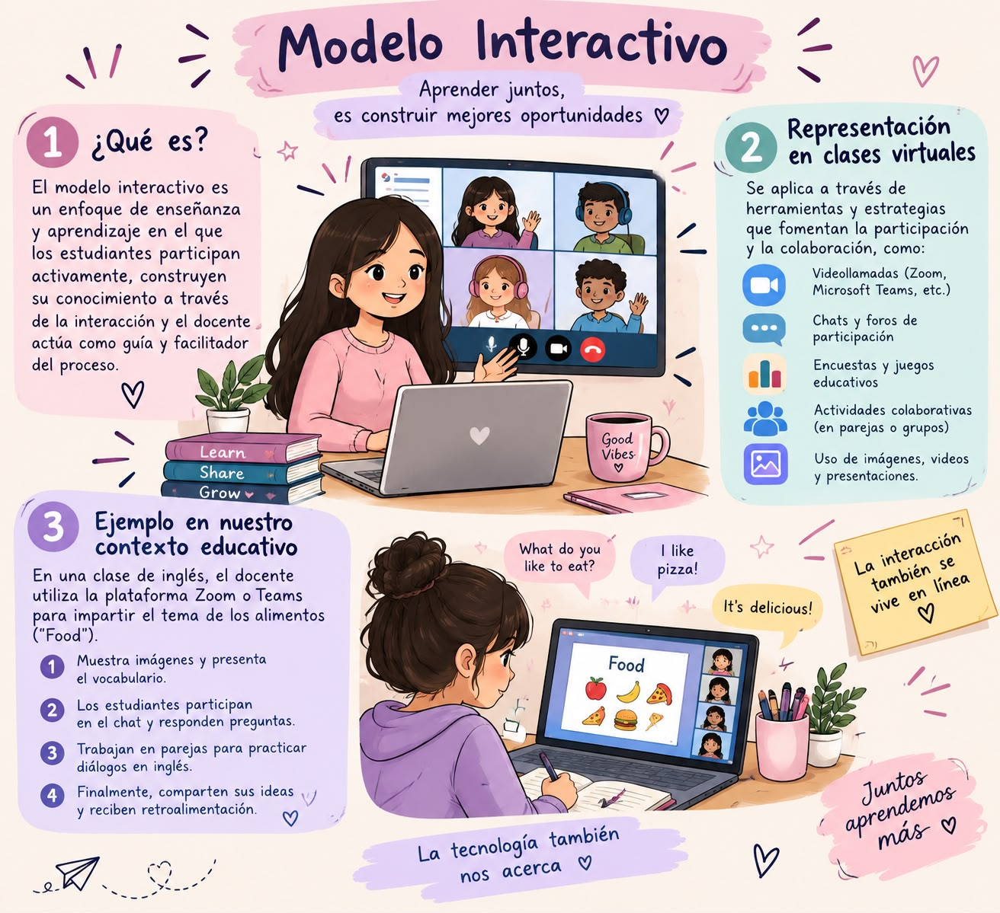
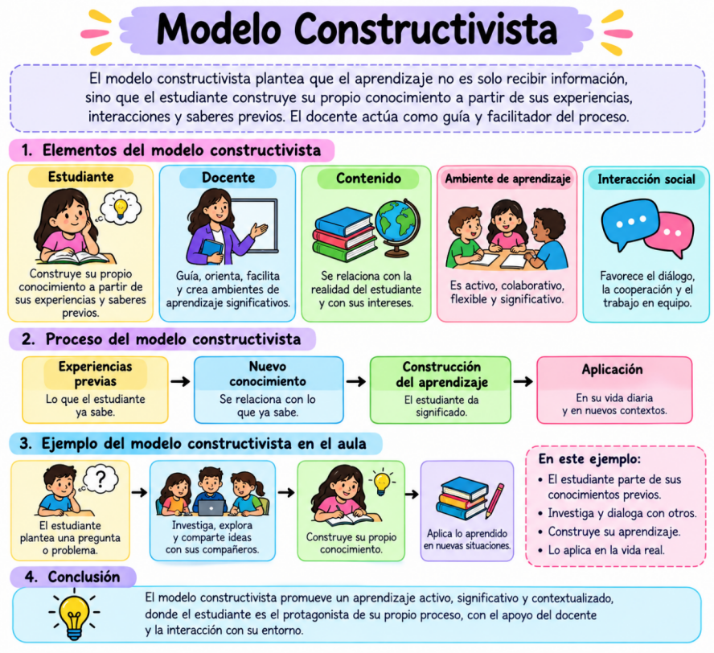
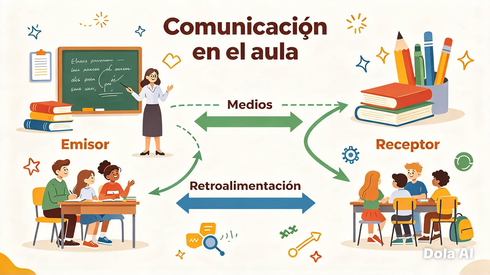
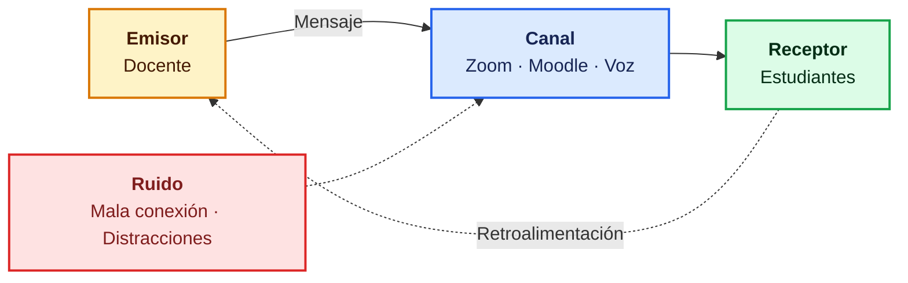
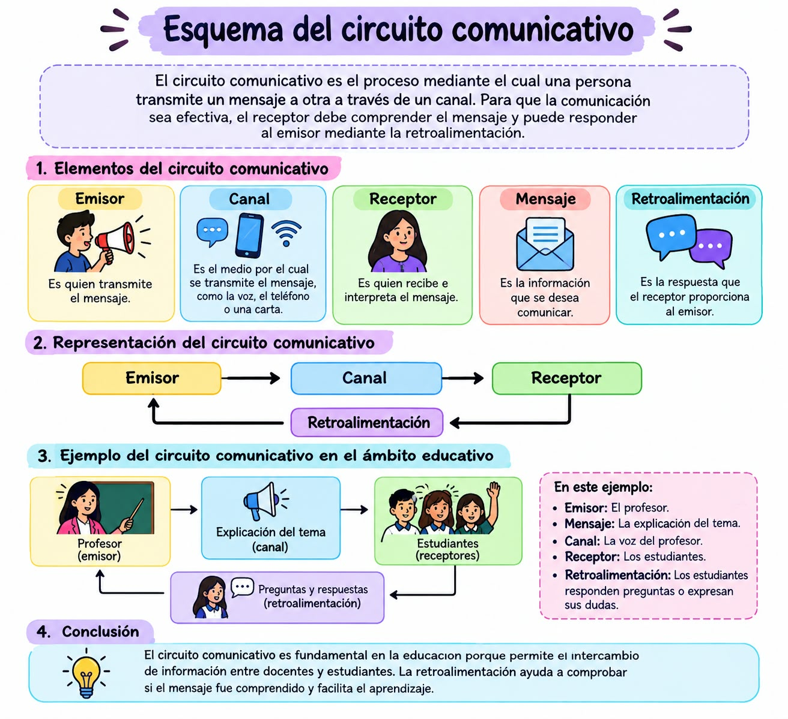

# 🧩 Enfoque de Aprendizaje Colaborativo (Metodología de Trabajo en Equipo): Armando el Circuito Comunicativo
   

## 📌 Título de la actividad
**Plano comunicativo – Patrulla Puma Exploradores**

## 🎯 Propósito de la actividad
> [!NOTE]
> Visualizar los modelos de comunicación, comprendiendo cómo fluye el aprendizaje en los entornos virtuales. Mediante el diseño de un circuito comunicativo, se identifican roles, rutas, interferencias y conexiones reales en nuestro contexto educativo.

## 👥 Integrantes del grupo
| Nombre | Rol en el grupo | Correo / Contacto |
|:--|:--|:--|
| 🧑‍🎓 **Jorge Lacayo** | Líder de proyecto | jorge.lacayo@oteima.ac.pa |
| 🧑‍🎓 **Madelene Delgado** |Especialista en Diagramación y Representación Visual | madelene.delgado@oteima.ac.pa |
| 🧑‍🎓 **Jovanny Canto** | Coordinador | jovanny.canto@oteima.ac.pa |
| 🧑‍🎓 **Diana Torres** | Especialista en Diagramación y Representación Visual | diana.torres@oteima.ac.pa |
| 🧑‍🎓 **Noris Robles** | Redactor y Revisor Técnico | noris.robles@oteima.ac.pa |
| 🧑‍🎓 **Keyla Camarena** | Redactor y Revisor Técnico | keyla.camarena@oteima.ac.pa |

## 🔌 Exploración de modelos de comunicación

### 1. Modelo Lineal

> [!NOTE]
> **Representación en clases virtuales:**
> Proceso unidireccional en el que un emisor codifica un mensaje, lo envía por un canal y un receptor lo decodifica, sin considerar la retroalimentación. Es el modelo típico de las clases pregrabadas y los videotutoriales: el estudiante consume el contenido a su propio ritmo, pero sin interacción.
>
> **Ejemplo en nuestro contexto educativo:**
> Un profesor que dicta una clase magistral o lee un aviso institucional sin permitir preguntas en ese momento, y asume que el mensaje fue asimilado por completo.

*Figura 1. Modelo lineal de la comunicación.*

### 2. Modelo Interactivo

> [!IMPORTANT]
> **Representación en clases virtuales:**
> El estudiante participa activamente (pregunta, responde, comparte ideas y realiza actividades) mientras el docente actúa como guía. Se apoya en videollamadas (Zoom, Microsoft Teams), plataformas educativas, chats, foros, encuestas, juegos educativos y actividades colaborativas.
>
> **Ejemplo en nuestro contexto educativo:**
> En el contexto educativo panameño, un docente de inglés da una clase virtual por Zoom o Teams. Tras explicar el vocabulario de los alimentos, muestra imágenes; los estudiantes los identifican, responden preguntas por el chat y, en parejas, crean un pequeño diálogo en inglés que luego presentan a la clase.

*Figura 2. Modelo interactivo.*

### 3. Modelo Constructivista

> [!TIP]
> **Representación en clases virtuales:**
> El estudiante construye su conocimiento a partir de sus experiencias previas y de la interacción con los demás, mientras el docente facilita y orienta. Se apoya en salas de trabajo pequeñas (Zoom, Teams), pizarras digitales colaborativas (Padlet, Miro), documentos y presentaciones compartidas (Google Docs, Canva) y foros de discusión asincrónicos.
>
> **Ejemplo en nuestro contexto educativo:**
> Estudio de caso y solución colaborativa: el docente plantea un problema real de la comunidad (por ejemplo, la gestión del agua). Los estudiantes investigan y debaten en subgrupos, crean juntos un informe o presentación interactiva y exponen sus conclusiones, recibiendo observaciones de sus compañeros y del docente.

*Figura 3. Modelo constructivista.*

## 💭 Reflexión
**¿Qué roles asumimos como emisores y receptores?**

En el aula, el docente suele ser el emisor principal al transmitir conocimientos, explicar temas y dar instrucciones, y los estudiantes actúan como receptores al escuchar, leer y comprender. Estos roles se intercambian constantemente: los estudiantes también son emisores al hacer preguntas, expresar ideas o exponer trabajos, y el docente pasa a ser receptor al escucharlos.

**¿Qué medios utilizamos?**

| Tipo | Medios |
|:--|:--|
| 🗣️ **Verbales** | Explicaciones orales, diálogos, debates, libros, cuadernillos, pizarras, apuntes y tareas escritas |
| 👀 **No verbales** | Miradas, gestos, postura, tono de voz y expresiones faciales |
| 💻 **Tecnológicos** | Proyectores, computadoras, plataformas educativas, videos y mensajes |

**¿Qué obstáculos interfieren en la comunicación?**

> [!WARNING]
> - Ruido en el aula o ambiente desordenado.
> - Falta de atención o concentración.
> - Explicaciones poco claras o confusas.
> - Diferencias en la forma de aprender o entender.
> - Prejuicios, timidez o miedo a participar.
> - Barreras físicas, como problemas de audición o visión.
> - Emociones como el estrés o la frustración.

*Figura 4. Comunicación en el aula.*

## 🔧 Diseño del circuito comunicativo
| Elemento | Quién / Qué | Detalles / Ejemplos | Representación visual |
|:--|:--|:--|:--|
| 🟡 **Emisor** | El docente o la fuente de contenido educativo | Explica el tema y da las consignas: una clase en Zoom, una instrucción en Moodle o un video explicativo | 👨‍🏫 Docente |
| 🟢 **Receptor** | El estudiante o el equipo de estudiantes | Recibe, interpreta y comprende el mensaje para construir su aprendizaje | 👩‍🎓 Estudiantes |
| 🔵 **Canal** | El medio por el cual viaja el mensaje | Moodle, videollamada (Zoom, Teams), pantalla interactiva, dispositivo móvil o la voz en el aula | 💻 📱 🗣️ |
| 🔴 **Ruido** | Todo lo que interfiere o distorsiona el mensaje | Mala conexión a internet, ruido ambiental, distracciones, explicaciones confusas, timidez o estrés | 📶 ❌ 🔊 |
| 🟣 **Retroalimentación** | La respuesta que regresa al emisor y valida el aprendizaje | Preguntas y respuestas en el chat, evaluaciones formativas, cuestionarios de autocomprobación y comentarios del docente | 🔄 💬 |

## 🔄 Esquema del circuito comunicativo
**[Emisor] ➡️ [Canal] ➡️ [Receptor]**
**[Receptor] ➡️ [Retroalimentación] ➡️ [Emisor]**

👨‍🏫 Profesor (emisor) ➡️ 🗣️ Explicación (canal) ➡️ 👩‍🎓 Estudiantes (receptores)
 ➡️ 💬 Preguntas y respuestas (retroalimentación) 

En este ejemplo, el emisor es el profesor, el mensaje es la explicación del tema, el canal es su voz, los receptores son los estudiantes y la retroalimentación son las preguntas, respuestas o dudas que ellos expresan.

## 📝 Conclusión
> [!IMPORTANT]
> El circuito comunicativo es fundamental en la educación porque permite el intercambio de información entre docentes y estudiantes. Al analizar los modelos lineal, interactivo y constructivista, nuestra patrulla comprendió que el aprendizaje en entornos virtuales mejora cuando la comunicación deja de ser unidireccional y se convierte en un diálogo en el que los estudiantes participan y construyen su conocimiento. La retroalimentación permite comprobar si el mensaje fue comprendido, y reducir el ruido (mala conexión, distracciones, timidez) es clave para que el aprendizaje fluya.

## 📎 Evidencia visual

*Figura 5. Esquema del circuito comunicativo en el ámbito educativo.*
